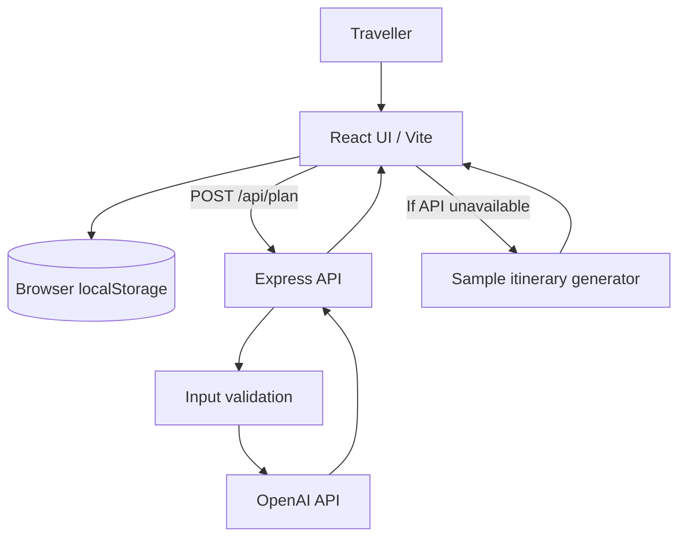

# WanderAI — AI-Powered Smart Travel Planner

**Final-year project report template**  
**Domain:** Travel & Tourism / Artificial Intelligence / Web Application  
**Frontend:** React, JavaScript, HTML5, CSS3, Vite  
**Backend:** Node.js, Express  
**AI integration:** OpenAI API (optional; demo mode is available without credentials)

> Student note: Replace all bracketed fields with your actual details, add your institution's prescribed cover page and certificate, and only describe testing/deployment that you personally completed. Do not present estimated sample itineraries as live travel data.

## 1. Abstract

WanderAI is a responsive web application designed to reduce the effort involved in planning leisure trips. Users can explore a curated destination catalogue, search and filter destinations, save favourites, and generate a day-by-day itinerary based on destination, trip duration, budget, group size, travel style and interests. The frontend is implemented using React and CSS. An Express backend exposes an itinerary endpoint and can connect to an AI model through a server-side API key. When credentials or the API are unavailable, a clearly labelled sample itinerary allows the application to be demonstrated without external services. Users can save itinerary plans locally and export them as text files. The project demonstrates component-based UI development, state management, browser storage, API integration, input validation, responsive design and responsible communication of AI limitations.

## 2. Problem statement

Travel planning often requires switching between multiple sources to collect destinations, activities and schedule ideas. This creates friction for users who have limited time or are unsure how to organise a trip around their preferences and budget. WanderAI provides a single starting point for discovery and itinerary ideation. It is a planning assistant, not a booking engine: live prices, availability, opening hours, visa requirements and transport schedules must be verified with authoritative providers.

## 3. Objectives

1. Build a responsive, accessible travel discovery interface.
2. Allow users to search and filter a curated list of destinations.
3. Support saving and removing favourite destinations.
4. Generate itinerary ideas from user-supplied trip preferences.
5. Keep AI credentials on the server rather than exposing them in browser code.
6. Support local demo mode, saving itineraries and exporting a text itinerary.
7. Document setup, API behaviour, limitations and test scenarios.

## 4. Scope

### Included
- Destination cards with category, description, approximate price indication and duration.
- Search and category filters.
- Favourite destinations persisted in browser local storage.
- Planner form for destination, days, budget, travellers, style and interests.
- Optional AI generation through an Express API.
- Clearly labelled demo itinerary fallback.
- Saved itinerary library (up to 12 plans) stored locally in the current browser.
- Text export and JSON copy actions.
- Responsive layout, keyboard focus indicators and reduced-motion support.

### Not included in this version
- User accounts, cloud synchronisation or a database.
- Real-time flight/hotel search, bookings, payments or confirmed availability.
- Verified live maps, weather feeds, visa advice or live travel prices.
- Multi-user sharing or administrator dashboard.

## 5. System architecture



The browser handles presentation, filtering and local persistence. The Express server validates request fields and uses a server-side environment variable for AI credentials. The fallback itinerary is labelled as sample/demo content and is not represented as a live AI result.

## 6. Main modules

| Module | Responsibility |
|---|---|
| Destination discovery | Search, category filters, destination cards |
| Favourites | Save/remove destination IDs in local storage |
| Trip planner | Collect preferences and submit a plan request |
| Demo itinerary | Provide a repeatable sample flow without credentials |
| AI API | Validate inputs and request structured itinerary JSON |
| Itinerary library | Save/delete plans locally and reopen a saved plan |
| Export | Download itinerary text and copy JSON where clipboard access is permitted |
| Responsive UI | Layout adaptation, keyboard focus and reduced motion |

## 7. Data and privacy

This version does not require account registration. Favourites and saved itineraries are stored in the current browser's local storage; they are not synced across devices and may be removed when browser site data is cleared. When live AI is enabled, the trip preferences submitted in the planner are sent to the configured backend and then to the selected AI provider. Do not enter sensitive personal information. The API key must be stored in `.env` on the server and must never be placed in a `VITE_` frontend variable or committed to version control.

## 8. Setup and execution

Requirements: Node.js 18 or newer and npm.

```bash
npm install
cp .env.example .env
npm run dev:full
```

On Windows PowerShell, use `Copy-Item .env.example .env`. Open `http://localhost:5173`. The API health endpoint is `http://localhost:8787/api/health`. Without a valid AI key, the UI can still demonstrate sample itinerary generation. To enable live AI, set `OPENAI_API_KEY` in `.env` and restart the server.

## 9. API specification

### `GET /api/health`
Returns whether the API process is running and whether an AI key is configured. It does not validate that the key has sufficient quota or is currently usable.

### `POST /api/plan`
Example request:

```json
{
  "destination": "Kyoto, Japan",
  "days": 5,
  "budget": "₹50,000 – ₹1,00,000",
  "travelers": 2,
  "style": "Slow & soulful",
  "interests": ["Food & cafés", "Culture"]
}
```

The API validates destination length, a duration of 1–14 days and a traveller count of 1–10. On successful AI generation, it returns JSON containing a title, introduction, estimated total, tips and a day-by-day list. Prices and activities are suggestions, not verified offers. Without a configured key, the endpoint returns a service-unavailable response and the frontend can switch to demo mode.

## 10. Testing plan

Use `docs/TEST_CASES.md` as the manual test checklist. Run `npm run build` before submission. Record the actual date, browser, result and evidence for each test you execute. A successful production build confirms compilation, not full end-to-end correctness.

## 11. Limitations and future enhancements

- Replace local storage with a database and add authentication for cross-device persistence.
- Add verified map routing and distance calculations using a mapping provider.
- Add weather and local event integrations with clear timestamps and sources.
- Add currency conversion, itemised budget estimates and editable daily activities.
- Add automated unit/integration tests and CI checks.
- Add accessibility audits and usability testing with participants.
- Add multilingual itinerary output and an explicit user-consent/privacy page.

## 12. Conclusion

WanderAI provides a practical foundation for preference-driven travel planning. It combines a responsive React interface, local persistence, a validated Express API and optional AI-generated itinerary content. Its demo mode and export tools make the core interaction easy to evaluate. Future iterations can extend it with persistent accounts and verified travel data while preserving clear distinctions between generated suggestions and confirmed facts.

## 13. Student details to complete

- **Student name / roll number:** [Fill in]
- **Department / institution:** [Fill in]
- **Project guide:** [Fill in]
- **Academic year:** [Fill in]
- **Screenshots and test evidence:** [Insert your own]
- **Deployment URL (if deployed):** [Insert verified URL]
